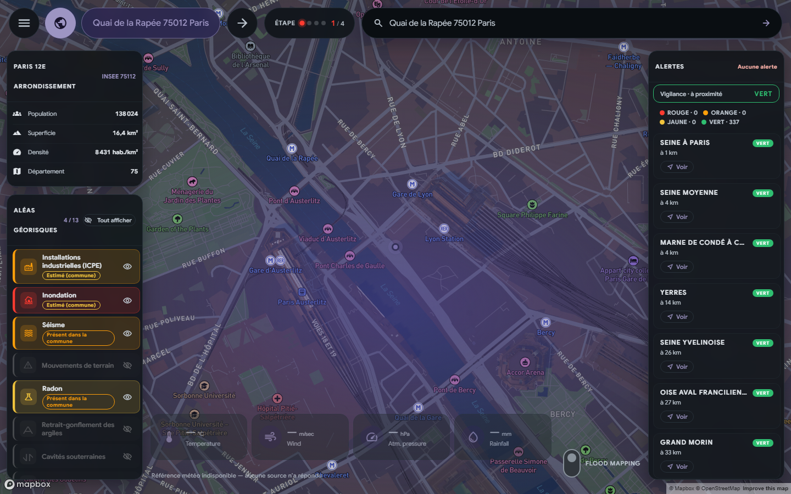
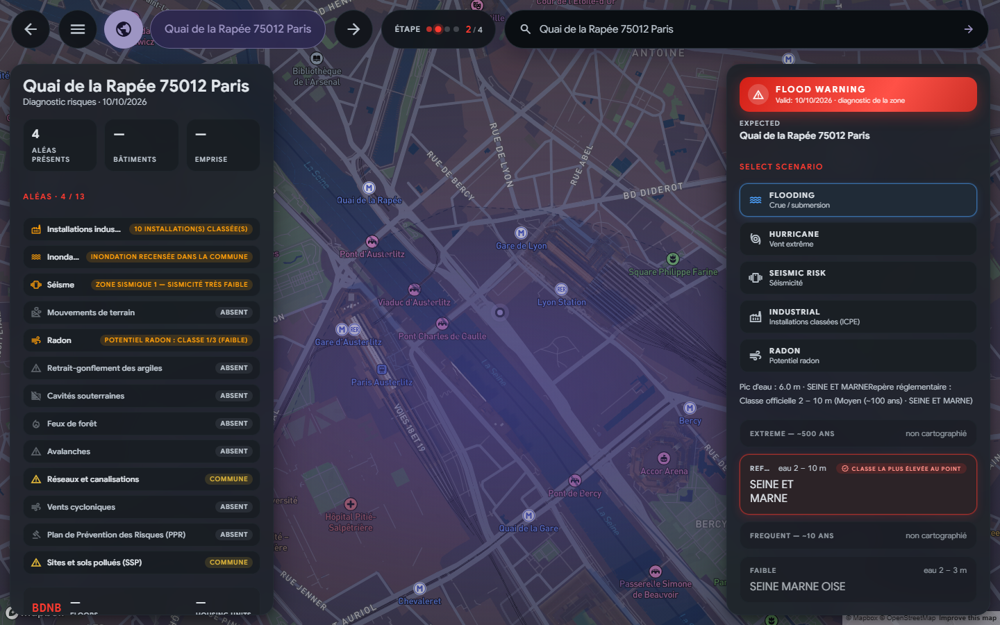
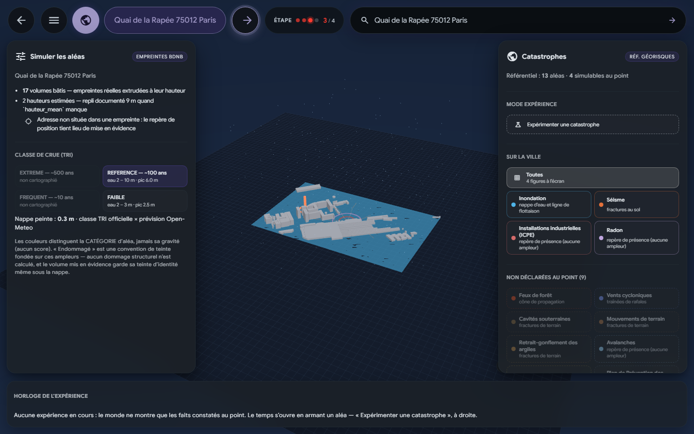
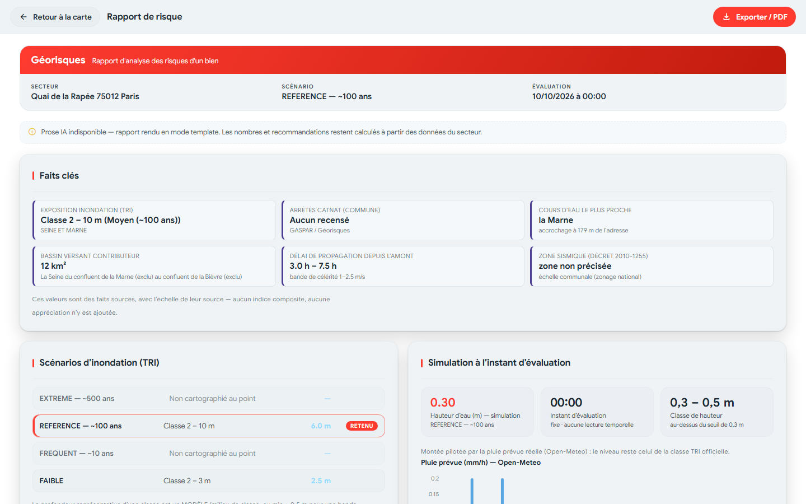
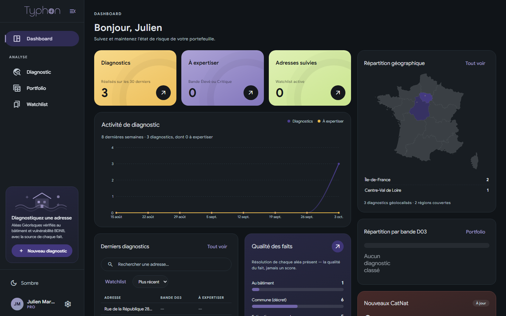
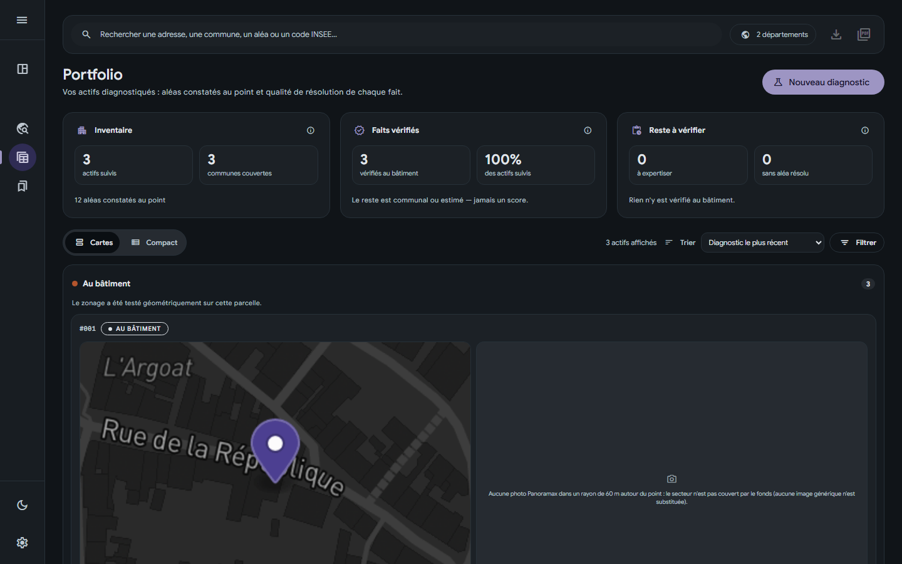
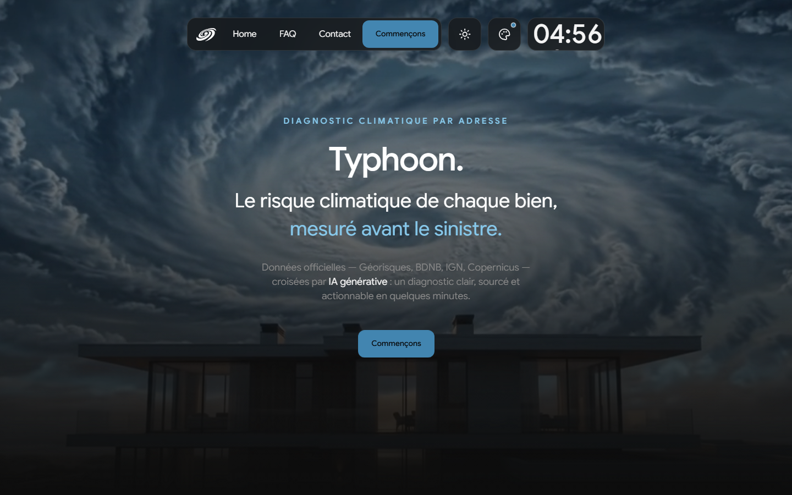
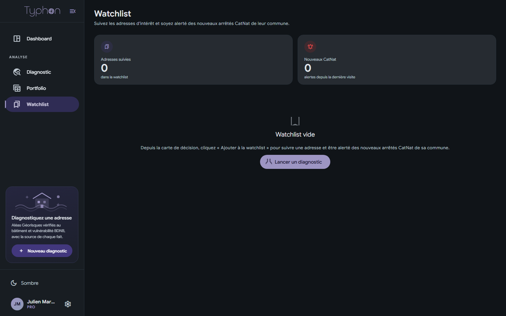

# Typhoon 2 — Données climatiques par bâtiment


**Démo en ligne** — <https://typhoon-rose.vercel.app>.

Service de données climatiques **par bâtiment** pour les assureurs français.
Une adresse → un JSON canonique joignant aléas réglementaires (Géorisques,
point-in-polygon WFS) et vulnérabilité BDNB (139 champs verbatim), avec
**provenance et niveau de résolution sur chaque fait**.

> Pas de score, pas de narration IA, pas de recommandations : l'assureur
> applique son propre modèle actuariel.

## Aperçu

Captures rejouées sur l'application (`frontend/scripts/demo-shots.mjs`), pas
composées pour l'illustration.

### Le tunnel, de l'adresse au rapport

| Étape 1 — Diagnostic | Étape 2 — Analyse |
|---|---|
|  |  |
| 13 aléas Géorisques au point — chacun avec sa résolution et sa provenance — commune INSEE, fiche BDNB, photo Panoramax sur carte 3D. | Classes de crue TRI officielles (fréquent ~10 ans, moyen ~100 ans, extrême ~500 ans) : le niveau vient de la classe réglementaire, jamais d'un curseur. |

| Étape 3 — Jumeau | Étape 4 — Rapport |
|---|---|
|  |  |
| Le bâti en volume dans son propre environnement WebGL : faits du cadre à gauche, catalogue des aléas à droite, horloge de l'expérience en bas. | Page autonome : scénario de référence, faits clés, provenance. La prose LLM est un appoint estampillé, jamais la source des nombres. |

### Les écrans de l'assureur

| Tableau de bord | Portefeuille |
|---|---|
|  |  |
| Volume diagnostiqué, biens à expertiser, activité, qualité des faits — lu depuis le cache local, sans rappeler les sources. | Le livre des actifs trié par **résolution du fait** : vérifié à la parcelle, estimé à la commune, ou manquant. |

| Landing | Connexion |
|---|---|
|  |  |

| Surveillance | Paramètres du compte |
|---|---|
|  |  |

> ⚠️ Ces captures proviennent d'un dev server local dont l'API pointe vers
> l'instance déployée (le poste de capture ne joint pas
> `www.georisques.gouv.fr`). L'instance étant en retard sur ce dépôt,
> `/api/meteo/france` y répond 404 : les cinq cartes météo de l'étape 2
> affichent donc « Référence météo indisponible ». C'est une divergence de
> versions, pas le comportement du code de ce dépôt.

Captures (rejouables) :

```bash
cd frontend
npm i -D playwright               # outil de capture, hors dépendances de l'app
node scripts/demo-shots.mjs       # dev server + API requis (voir l'en-tête du script)
```

## Fonctionnalités

### Étape 1 — Diagnostic (`/zone`)
- Recherche d'adresse (géocodage BAN) → carte 3D Mapbox avec bâtiments BDNB
- 13 aléas Géorisques (ICPE, inondation, sismique, PPR, radon, argile,
  cavités, feux, avalanches, canalisations, vent cyclonique, SSP, mouvements
  de terrain) avec badge de résolution : `per-building` (vérifié par test
  géométrique WFS) / `commune-level` (décret) / `commune-level-estimate`
- Fiche BDNB du bâtiment (usage, hauteur, emprise, matériaux, fiabilité adresse)
- Photo terrain Panoramax orientée sur le point
- Vigilances crues (Vigicrues) par bassin versant
- Historique CatNat et watchlist assureur (localStorage)

### Étape 2 — Simulation de scénarios
- **Classes TRI officielles** (Directive Inondation) : fréquent ~10 ans,
  moyen ~100 ans, extrême ~500 ans, faible — profondeur d'eau réglementaire
  au point, jamais inventée
- Timeline horaire + bouton Play : l'eau monte sur le bâtiment (extrusion
  Mapbox), le scénario pilote le pic, la pluie prévue n'en pilote que la forme
- Journée sèche → rampe divergée documentée, libellé « montée : hypothèse »
- Absence ≠ panne : « hors TRI », « dans un TRI sans classe au point » et
  « service indisponible » sont trois messages distincts
- Aléa feu : cône d'exposition orienté vent réel sur la carte
- Mode VFX optionnel (rendu cinématique non contractuel, toujours `partial`)
- Rapport PDF exportable (jsPDF) avec graphiques et provenance

### Backend — API FastAPI
| Route | Description |
|---|---|
| `POST /diagnostic/adresse` | Adresse → DiagnosticRecord canonique |
| `POST /diagnostic/batch` + `GET /diagnostic/batch/{id}` | Batch = N × pipeline unitaire |
| `GET /diagnostic/adresse/rapport-pdf` | Rapport PDF |
| `GET /diagnostic/zone/building(s)` | Fiches BDNB autour du point |
| `GET /api/flood-alea` | Classes TRI au point (Géorisques WFS, point-in-polygon) |
| `GET /api/hydro`, `/api/hydro/extend` | Tracé hydrographique (Sandre) |
| `GET /api/meteo` | Pluie horaire + débit GloFAS (Open-Meteo) |
| `GET /api/photo` | Photo Panoramax + crédit |
| `GET /api/report`, `/api/report/stream` | Rapport narratif (Mistral, template si clé absente) |
| `GET /api/geocode/search` | Autocomplétion BAN |
| `GET /health`, `/health/detailed` | Sonde de vie |

## Démarrage rapide

```bash
# Backend (Python 3.11+)
cd backend
python -m venv venv && venv/Scripts/activate   # ou source venv/bin/activate
pip install -r requirements.txt
uvicorn app.main:app --reload --port 8000

# Frontend (Node 18+)
cd frontend
npm install
npm run dev        # http://localhost:5173
```

Copier `.env.example` vers `.env` **à la racine du dépôt** (le frontend lit
les variables `VITE_*` depuis là via `envDir: '..'`) et renseigner :

| Variable | Usage |
|---|---|
| `VITE_MAPBOX_TOKEN` | Jeton public Mapbox (étape 1 & 2) |
| `VITE_SUPABASE_URL` / `VITE_SUPABASE_PUBLISHABLE_KEY` | Auth |
| `VITE_WINDY_API_KEY` | Overlay météo |
| `MISTRAL_API_KEY` | Prose du rapport (sinon rendu template) |
| `CDSAPI_KEY` / `CDSAPI_URL` | Copernicus CDS |
| `PARTNER_API_KEYS` | Endpoints fermés si absent (mode dev) |

## Démo — adresses de référence (re-vérifiées live 2026-10-10)

| Adresse | Rôle | Résultat vérifié |
|---|---|---|
| **Quai de la Rapée, 75012 Paris** | Démo principale — eau sur le bâtiment | `in_tri: true` · classes `moyen` et `faible` cartographiées au point · 4/13 aléas constatés présents (ICPE, inondation, sismicité, radon) |
| **10 Quai de la Charente, 75019 Paris** | Absence honnête — dans un TRI sans classe au point | `in_tri: true`, aucune classe cartographiée au point : message distinct, aucun chiffre inventé |
| **Rue de la République, 28160 Brou** | Contraste « hors TRI ≠ jamais inondé » | `available: false` — commune rurale, hors périmètre TRI |

⚠️ `Brou 28300` **n'est pas** une adresse valide : le code postal de Brou est
`28160`, et le géocodeur répond `adresse_ambigue` sur `28300` (qui désigne
Saint-Prest). L'API refuse alors de diagnostiquer plutôt que de choisir à la
place de l'utilisateur — comportement voulu, mais le message affiché se limite
à `error score 0.31` et perd le libellé proposé (`label_propose`)
(défaut d'interface connu : `docs/screenshots/11-adresse-ambigue.png`).

Déroulé suggéré : Rapée (diagnostic → étape 2 → Moyen → jumeau) →
Charente (rigueur : message distinct, aucun chiffre inventé) → Brou (hors TRI) →
export PDF.

## Tests & qualité

```bash
# backend (depuis backend/)
python -m pytest tests/ -q     # 261 tests hors-ligne, ~3 min 54 (mesuré 2026-10-10)
ruff check app tests

# frontend (depuis frontend/)
npm test                       # 521 tests vitest (63 fichiers)
npm run build                  # tsc -b && vite build
```

La suite est **hors-ligne** (fixtures GML capturées, sources mockées) et doit
rester verte avant tout commit. Les tests live Géorisques sont un tiers séparé.

## Architecture

```
backend/
  app/api/routes/        diagnostic, flood, hydro, photo, report, geocoding, health
  app/connectors/        bdnb, georisques (REST + WFS per-building), flood_alea
                         (classes TRI), hydro (Sandre), meteo (Open-Meteo),
                         copernicus, geocoding (BAN), site_photo (Panoramax)
  app/services/          canonical (pipeline unitaire), batch, budget, limits,
                         report_agent (Mistral + cache)
  app/schemas/           diagnostic_record (contrat sérialisé, refuse les
                         champs interdits), flood, report
  app/core/              config, logging, api_key, rate_limit

frontend/
  src/routes/            Zone (/zone), ReportPage, Dashboard, Portfolio, WatchlistPage…
  src/components/        UnifiedMap (Mapbox 3D), ScenarioPanel, RiskConsole,
                         FloodConsole, RiskPanel, VfxDisclaimer…
  src/zone/              moteur scénario : floodAlea (client TRI), floodSim
                         (scenarioDepthAt), damageModel, impactModel, hazardSim,
                         windSim, exposure, hydroRoute, hydroLayer, pdf-export
  src/typhoon/           chrome applicatif, auth, navigation
```

### Pièges connus (AGENTS.md — à lire avant toute modification)
- Le WFS Géorisques exige un `AsyncClient` **dédié** (keep-alive lié au
  backend ; mélanger REST/WFS provoque des 404 en cascade)
- GML 3.2 uniquement ; ordre d'axes (lat, lon) quand `srsName` URN EPSG::4326 ;
  le `srsName` peut vivre sur l'`Envelope`/`MultiSurface` sans se répéter sur
  chaque `Polygon` — l'hériter, sinon point-in-polygon ne matche jamais
- Une réponse WFS vide est **ambiguë** (hoquet MapServer) : rejouer une fois
- Arrondissements Paris/Lyon/Marseille : retranslater vers la commune parente
- Géocodeur : 429 + Retry-After à 50 req/s/IP — helper `_get_with_429_retry`

## Documentation

- `AGENTS.md` — méthodologie spec-driven, invariants acquis, pièges
- `docs/workflow/` — spec, plans (scénarios SCN-xxx, VFX), notes de décision
- `handoff.md` — décisions architecturales en attente

## Licence

MIT — voir [LICENSE](LICENSE).

## Convention de commit

Messages concis, préfixés du domaine : `feat(etape2): …`, `fix(flood): …`,
`test(SCN-xxx): …`, `docs: …`, `chore: …`. Un commit `test(TXXX)` échouant
puis un commit `feat(TXXX)` pour toute feature (workflow spec-driven).
